# Polarapt HCM — Real-Time External Data Platform on AWS

> Data Engineering Hackathon (Batch 05) · Oct 24–25, 2026

Polarapt HCM needs a real-time external data backbone. This project ingests **three public HR data feeds every minute** into Amazon S3, then routes each one **by source** to its own **SQS FIFO queue, processor and target store**: Snowflake, an S3 processed zone, and SQL Server.

| Feed | What it gives | HCM modules |
|---|---|---|
| **USAJOBS** Search API | up to 500 current US federal job postings per call | 05 Talent Acquisition, 11 Workforce Intelligence |
| **BLS** Highest Paying Occupations (scraped) | top 10 occupations by median annual pay | 04 Compensation, 07 Career Intelligence |
| **Open Exchange Rates** | live USD → PKR, SAR, AED, GBP, EUR, INR | 04 Payroll |

---

## Architecture

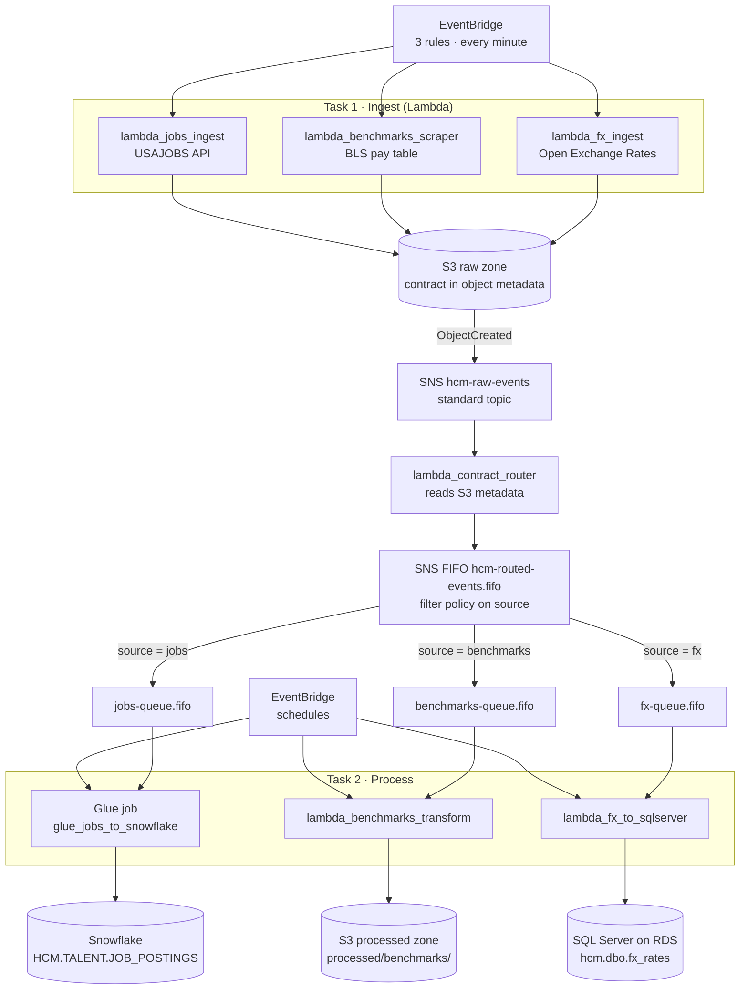

Each FIFO queue has its own **dead-letter queue** (`jobs-dlq.fifo`, `benchmarks-dlq.fifo`, `fx-dlq.fifo`, maxReceiveCount 3).

---

## Requirement checklist

| Requirement (hackathon brief) | Implementation | Proof |
|---|---|---|
| Lambdas `lambda_jobs_ingest`, `lambda_benchmarks_scraper`, `lambda_fx_ingest` | `src/polarapt/ingest.py` | [06](#screenshots) |
| EventBridge rule triggers each Lambda every minute | `hcm-ingest-{jobs,benchmarks,fx}-every-minute` | [04](#screenshots) |
| Bucket `data-hackathon-smit-yourname` | `data-hackathon-smit-verdankumar` | [02](#screenshots) |
| Files under `raw/`, by source and date: `raw/jobs/YYYY/MM/DD/HHMM.json` | `src/polarapt/contract.py` | [02](#screenshots) |
| Contract (timestamp, source, record count, response status) as **S3 object metadata and in the file** | `x-amz-meta-*` + `"contract"` block | [03](#screenshots) |
| S3 → standard SNS → router Lambda reads metadata → SNS FIFO `hcm-routed-events.fifo` with `source` attribute | `src/polarapt/router.py` | [07](#screenshots) |
| SNS filter policies → `jobs-queue.fifo`, `benchmarks-queue.fifo`, `fx-queue.fifo` (one message per file per minute) | filter `{"source": ["<name>"]}`, raw delivery | [07](#screenshots) [08](#screenshots) |
| EventBridge triggers each processor | Lambda rules every minute; EventBridge Scheduler → Glue every 5 min | [04](#screenshots) [05](#screenshots) |
| **Benchmarks → S3 processed** | `src/polarapt/process_benchmarks.py` | [09](#screenshots) |
| **FX → SQL Server** | `src/polarapt/process_fx.py` (RDS SQL Server Express) | [10](#screenshots) |
| **Jobs Glue script → Snowflake** | `src/polarapt/glue/jobs_to_snowflake.py` | [11](#screenshots) [12](#screenshots) |

---

## Data contract (Task 1)

Every raw file is written to `s3://data-hackathon-smit-verdankumar/raw/<source>/YYYY/MM/DD/HHMM.json`.

**S3 object metadata** (what the router reads):

| Key | Example |
|---|---|
| `x-amz-meta-source` | `jobs` |
| `x-amz-meta-ingested-at` | `2026-10-24T20:20:00Z` |
| `x-amz-meta-record-count` | `500` |
| `x-amz-meta-response-status` | `200` |
| `x-amz-meta-schema-version` | `1` |

**File body:** the same contract plus the untouched API response:
```json
{
  "contract": {"source": "fx", "ingested_at": "2026-10-24T20:19:00Z", "record_count": 6,
               "response_status": 200, "schema_version": "1"},
  "payload":  {"base": "USD", "timestamp": 1761336000, "rates": {"PKR": 281.35, "SAR": 3.75, "...": "..."}}
}
```
The raw zone is **immutable and replayable**: every processed record links back to the raw file it came from (`raw_key`).

---

## Targets (Task 2)

**Snowflake: `HCM.TALENT.JOB_POSTINGS`** (Glue Python shell job)
- One row per job (`CONTROL_NUMBER` primary key), loaded with **MERGE**. A job seen again every minute is updated, never duplicated. `FIRST_SEEN_AT` is kept, and `LAST_SEEN_AT` is refreshed.
- Pay normalised to annual: per year ×1, per hour ×2087, per day ×260, bi-weekly ×26; "without compensation" becomes null.

**S3 processed zone: `processed/benchmarks/`**
- `YYYY/MM/DD/HHMM.json` + `.csv` + `latest.json`, holding the top 10 occupations ranked by median annual pay. The pay year is read from the table header ("2025 MEDIAN PAY"), so the parser doesn't break when BLS changes the year.

**SQL Server (Amazon RDS, Express): `hcm.dbo.fx_rates`**
- `PRIMARY KEY (currency, rate_ts)`, `DECIMAL(19,6)` rates, loaded with **MERGE** (idempotent).

---

## Reliability and design decisions

- **Routing by contract, not by file name.** The router reads the S3 object metadata, so the queues receive only verified, labelled events.
- **FIFO ordering per source.** `MessageGroupId = source` and `MessageDeduplicationId = sha256(s3 key)`, so a file is never routed twice.
- **Dead-letter queues.** A message that fails 3 times is parked in `<source>-dlq.fifo` instead of being lost or blocking the pipeline forever.
- **Delete only after success.** Processors delete a message only after the target write commits.
- **Queues as a buffer.** While SQL Server was still being created, FX messages waited in the queue and loaded automatically once it was available, with no data loss.
- **Data quality checks.** Rows without an ID or title are dropped; BLS results are re-sorted rather than trusting page order; the run fails loudly if fewer than 10 rows parse; FX rates must be positive, with USD as the base.
- **Secrets stay out of code.** SQL Server and Snowflake credentials live in **AWS Secrets Manager**. Snowflake uses **key-pair authentication** (an RSA service user), not a password.
- **Least-privilege IAM.** Separate roles for Lambda, Glue and the Scheduler, each scoped to this project's bucket, queues and secrets.
- **Infrastructure as code.** `python -m polarapt.deploy` creates or updates everything idempotently; `--pause`, `--resume` and `--destroy` are included.

**Known trade-offs (hackathon scope):**
- SQL Server is publicly reachable on 1433 so that Lambda needs no VPC or NAT. Production would use private subnets, VPC Lambdas and secret rotation.
- The Glue Python shell installs the Snowflake connector on each run (about 1 minute). Production would use a prebuilt wheel in S3.
- The Open Exchange Rates free plan allows 1,000 calls a month, so every-minute polling is paused after the event.

---

## Screenshots

| # | Proof |
|---|---|
| 01 | Live platform status (all sources, queues, targets) |
| 02 | S3 raw zone, partitioned by source and date |
| 03 | S3 object metadata contract |
| 04 | EventBridge rules (3 ingest + 2 processors, every minute) |
| 05 | EventBridge Scheduler → Glue job |
| 06 | Lambda functions |
| 07 | SNS FIFO topic with 3 filtered subscriptions |
| 08 | SQS FIFO queues + DLQs |
| 09 | S3 processed benchmarks |
| 10 | FX loaded into SQL Server (Lambda log) |
| 11 | Glue job runs |
| 12 | Snowflake job postings |

### 01 · Live status
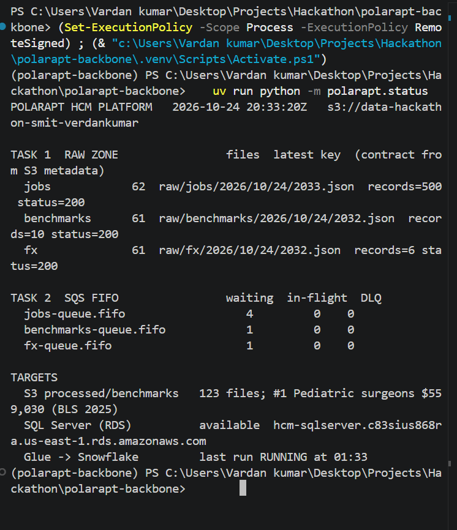
### 02 · S3 raw zone
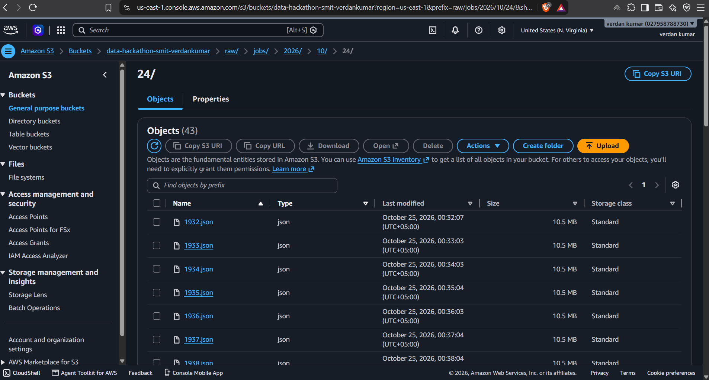
### 03 · S3 object metadata (contract)
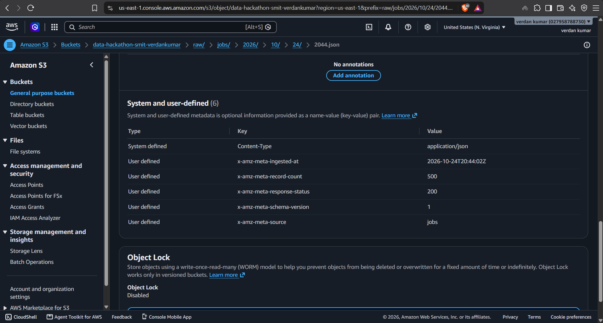
### 04 · EventBridge rules
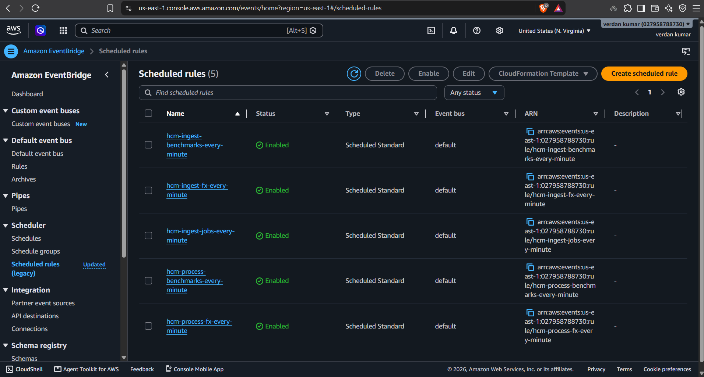
### 05 · EventBridge Scheduler (Glue)
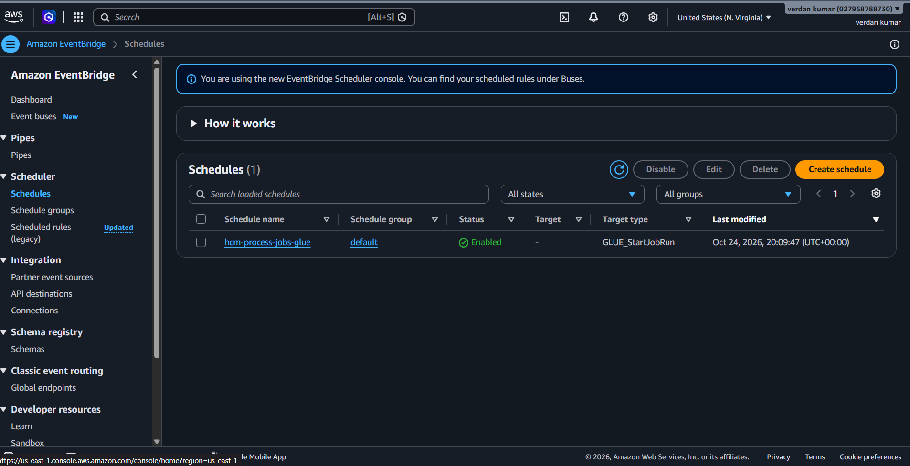
### 06 · Lambda functions
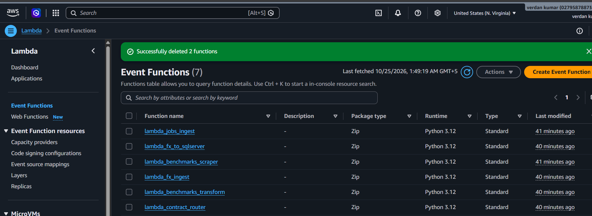
### 07 · SNS FIFO subscriptions with filter policies
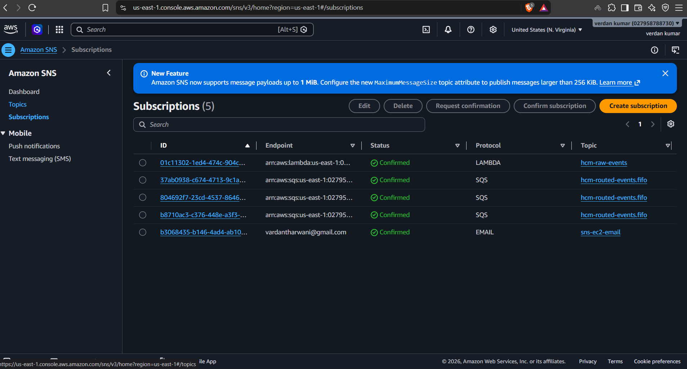
### 08 · SQS FIFO queues and DLQs
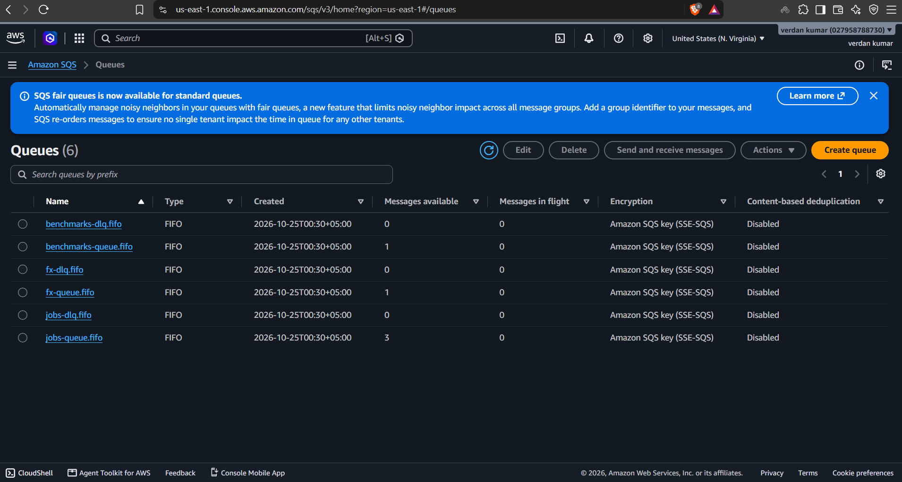
### 09 · S3 processed benchmarks
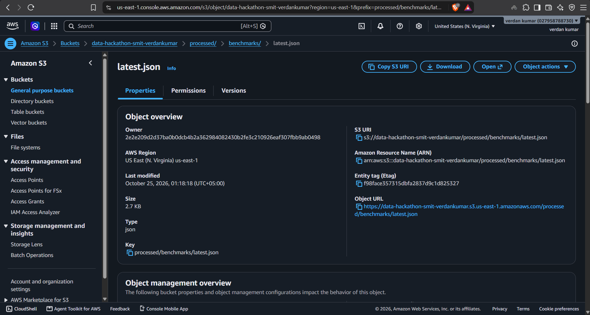
### 10 · FX into SQL Server
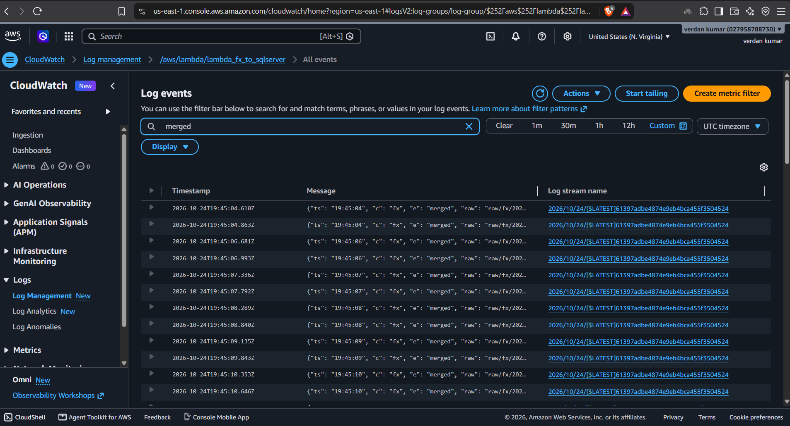
### 11 · Glue job runs
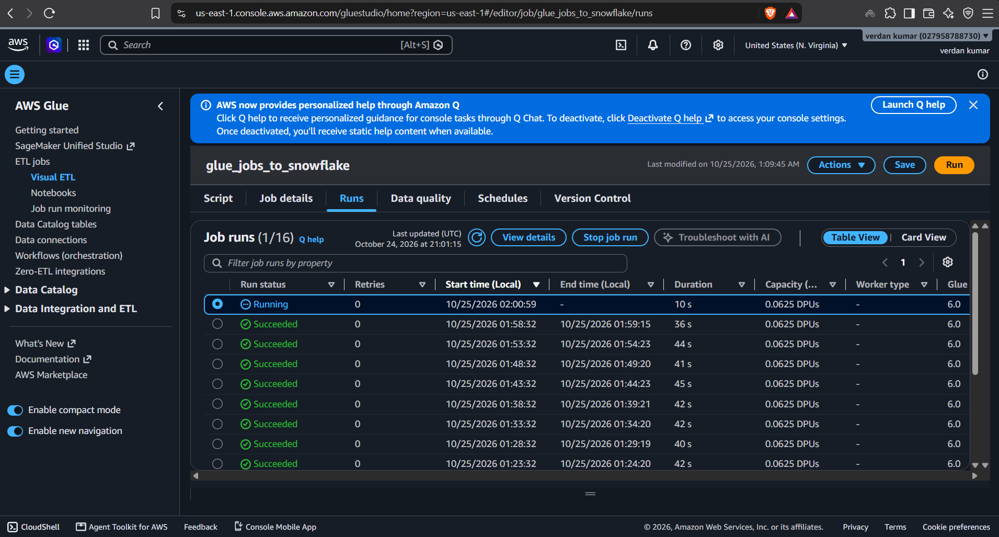
### 12 · Snowflake JOB_POSTINGS
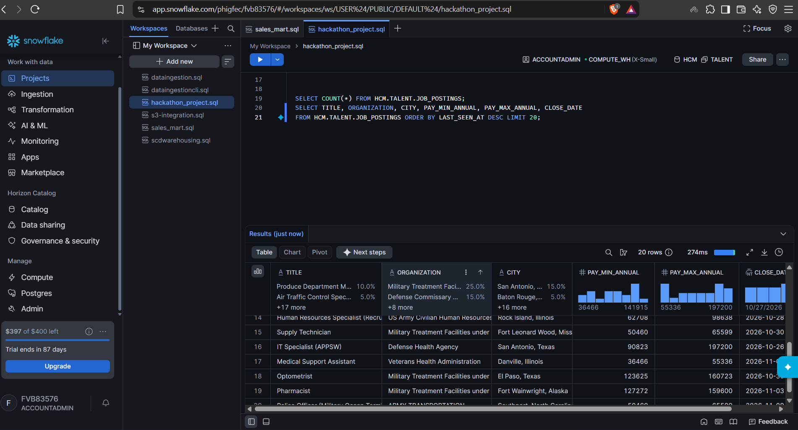

---

## Repository structure

```
src/polarapt/
├── ingest.py               # Task 1: lambda_jobs_ingest / lambda_benchmarks_scraper / lambda_fx_ingest
├── contract.py             # raw key layout + S3 metadata contract
├── router.py               # lambda_contract_router (S3 metadata -> SNS FIFO)
├── drain.py                # shared SQS FIFO consumer (delete after success)
├── process_benchmarks.py   # lambda_benchmarks_transform -> S3 processed
├── process_fx.py           # lambda_fx_to_sqlserver -> SQL Server
├── glue/jobs_to_snowflake.py   # Glue job -> Snowflake
├── producers/              # API / scraping clients (USAJOBS, BLS, OXR)
├── processors/             # pure parsers (unit-tested)
├── snowflake_setup.py      # key-pair + Snowflake role/user SQL + secret
├── deploy.py               # creates every AWS resource (idempotent)
└── status.py               # one-screen live health view
tests/                      # parser + contract tests (uv run pytest -q)
fixtures/                   # sample payloads for offline tests
docs/                       # SPEC.md, RUNBOOK.md, screenshots/
```

## Run it yourself

```powershell
uv sync --extra dev
copy .env.example .env      # fill AWS keys, BUCKET_OWNER, USAJOBS key + email, OXR App ID
uv run pytest -q
uv run python -m polarapt.deploy
uv run python -m polarapt.snowflake_setup --account <ORG-ACCOUNT>   # then run snowflake_setup.sql in Snowsight
uv run python -m polarapt.deploy                                    # enables the Glue schedule
uv run python -m polarapt.status --watch 15
uv run python -m polarapt.deploy --destroy                          # remove everything
```
Step-by-step guide: [docs/RUNBOOK.md](docs/RUNBOOK.md) · Design spec: [docs/SPEC.md](docs/SPEC.md)

**Tech:** Python 3.12 · AWS Lambda · Amazon EventBridge (Rules + Scheduler) · Amazon S3 · Amazon SNS (standard + FIFO) · Amazon SQS FIFO · AWS Glue · Amazon RDS for SQL Server · Snowflake · AWS Secrets Manager · IAM · BeautifulSoup · boto3
